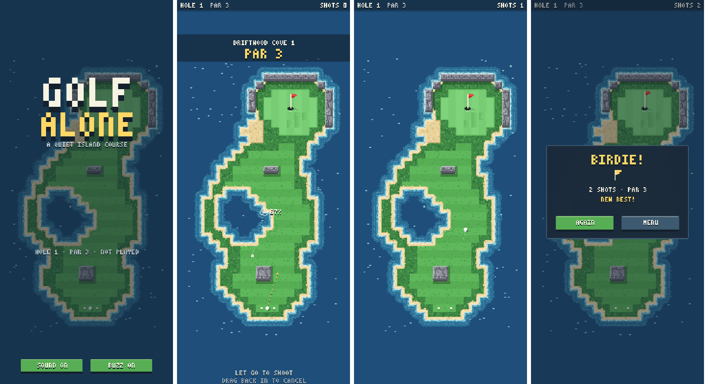

# Golf Alone

A top-down, pixel-art golf game for Android. Pull back anywhere on the screen to aim, let go
to shoot, and play a quiet island course alone.



**Status:** Driftwood Cove, a full 6-hole course (par 21). See [the plan](docs/PLAN.md) and
[the visuals, UI and course plan](docs/POLISH_AND_COURSE_PLAN.md).

## What's in
- **Driftwood Cove, 6 holes:**
  - **First Light:** rocks and a tide pool.
  - **The Spit:** a narrow neck between two seas.
  - **Driftwood:** a bowl ringed with bouncy logs, played with bank shots.
  - **Tide Pools:** a long par 5 that scrolls, ending in an island green.
  - **Palm Grove:** palm trunks to thread through.
  - **The Saddle:** a ridge green with slopes falling away.
- **Play modes:** play the full course, with a running score against par and a scorecard at the
  end, or practise any hole you've unlocked.
- **Forgiving water:** splashes follow the drawn coastline, and only once the whole ball is in.
  A slow ball teeters on the edge, and a splash drops you ashore near where you went in.
- **Ramps and flight:** roll up a wooden ramp fast to jump water and low walls. The ball's shadow
  stays on the ground while it flies.
- **Thumb-first menus:** every menu is a sheet of scorecard paper rising from the bottom, with
  the main driftwood button lowest and biggest.
  - Hole select is a swipe carousel.
  - Tap anywhere after a hole to carry on.
  - Rounds save after every hole, and the title offers Continue.
  - Settings: effects and surf volume sliders, vibration, left-handed, reduce motion,
    status bar (hidden in play by default) and pull length (short, normal, long).
  - In practice, hold the pause chip to restart the hole at once.
- **The Book** (on the title): your stats (rounds, aces, eagles, birdies, pars, jumps, longest
  shot, best and average per hole) and a postcard of every hole you've beaten par on.
- **While playing:** the top strip is information only.
  - Pause is a chip in the bottom corner that fires only on a clean tap.
  - Hold still to peek at the green.
- **Pixel-art style** ([rules](docs/STYLE_AND_UI_PLAN.md)):
  - a 3/4 view, with island banks and walls that show a front face
  - hue-shifted colour ramps
  - grass tufts and shells in clusters instead of noise
  - soft offset shadows and a 6 px outlined ball
  - a 5×7 pixel font
  - cloud shadows, swaying palms and dissolve transitions
  - dawn on Driftwood Cove, as a swap of the colour ramps (not a filter)
  - sun glints on open water, crabs on the beaches, butterflies, fish rings in ponds and a gull
    that rests on a wall until the ball comes by
  - a glide across the sea between holes, and a title that drifts from hole to hole
- **Drag and pull back from anywhere.** Your thumb never covers the ball.
  - Power climbs with the drag, with a haptic tick and a click at every 10%.
  - Aim dots warm from white to gold to orange, and blink at full power.
  - Drag back to where you started to cancel; it costs no stroke.
  - Touches that start in the system gesture zones are ignored, so Back and Home don't fire by accident.
- **Physics:** a fixed 240 Hz step in pure Kotlin (`game/Physics.kt`), so a shot plays out the same
  at 60 and 120 Hz.
  - Each ground type has its own friction: fairway, rough, green and sand.
  - Stone walls bounce the ball, and slopes on the green pull it downhill.
  - The cup catches slow balls with a gentle funnel. Fast balls lip out.
  - Water costs a stroke and returns the ball to where it was hit from.
- **Pixel art:** everything is drawn into a buffer about 180 logical pixels wide and scaled by a whole
  number with no filtering (6× on a 1080-wide Pixel).
  - The terrain is generated in code from an ASCII map: mown stripes, rough tufts, beaches, stone
    blocks with shadows, and animated foam and ripples.
  - The camera glides at sub-pixel precision.
- **Feel:** haptics built from the vibrator's primitives, and a live synth (ported from Arrow Unwind)
  for club knocks, wall taps, sand, splashes, lip-outs, a cup jingle and distant surf. Gulls fly over.
  - A club swoosh, a trail that warms with power, splash and landing-dust sprites, and "SO CLOSE!"
    for a near miss.
  - An ace or an eagle slows down for its last stretch to the cup, then gulls lift off the green;
    the result word lands on the card like a rubber stamp.
- **Battery:** the screen draws at 30 fps when nothing moves and at the panel's rate otherwise. Long
  press the logo for a frame-time overlay.
- **Title screen and scorecard:** a result word (birdie, par, bogey…), the flag you earned, and
  your best score, saved on the device.

## Install
Get `GolfAlone.apk` from the **latest** release (GitHub Actions builds it on every push) and open
it on your phone. Allow "install unknown apps" for your browser if asked. It installs alongside
Arrow Unwind.

## Build
Requires JDK 17+ and the Android SDK (platform 35).

```
./gradlew testDebugUnitTest            # physics, hole completability, UI playthrough
./gradlew testDebugUnitTest -Pshots=/tmp/shots   # also saves screenshots
./gradlew assembleRelease              # app/build/outputs/apk/release/app-release.apk
```

`app/golfalone-sideload.keystore` is a deliberately public signing key (password `android`), so
local and CI builds can be installed over each other. Use your own private key before publishing
to an app store.

## Code map
- `game/Hole.kt`: tile types and the ASCII hole format
- `game/Holes.kt`: the hand-made holes
- `game/Physics.kt`: deterministic fixed-step ball physics and events
- `game/ShotPlanner.kt`: a beam-search bot that proves each hole can be finished at par (`HoleCompletableTest`)
- `render/Terrain.kt`: per-pixel ground and the animated water overlays
- `render/PixelFont.kt`, `render/Palette.kt`: the 3×5 font and colours
- `GameView.kt`: the game loop, rendering, input, effects and every screen
- `render/Sprites.kt`: string-grid sprites (ball, flag, icons), palms and clouds
- `render/Pix.kt`: pixel drawing helpers, paper, planks and dissolves
- `docs/style/`: the style board, its script and the sprite contact sheet
- `Sfx.kt`, `Haptics.kt`, `audio/`: sound and vibration
